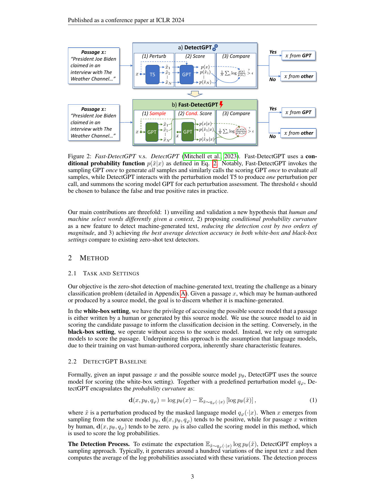
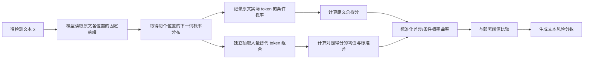
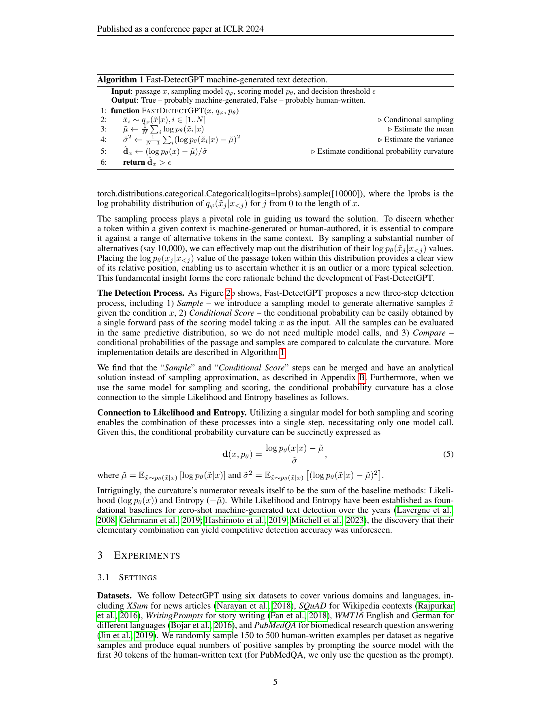
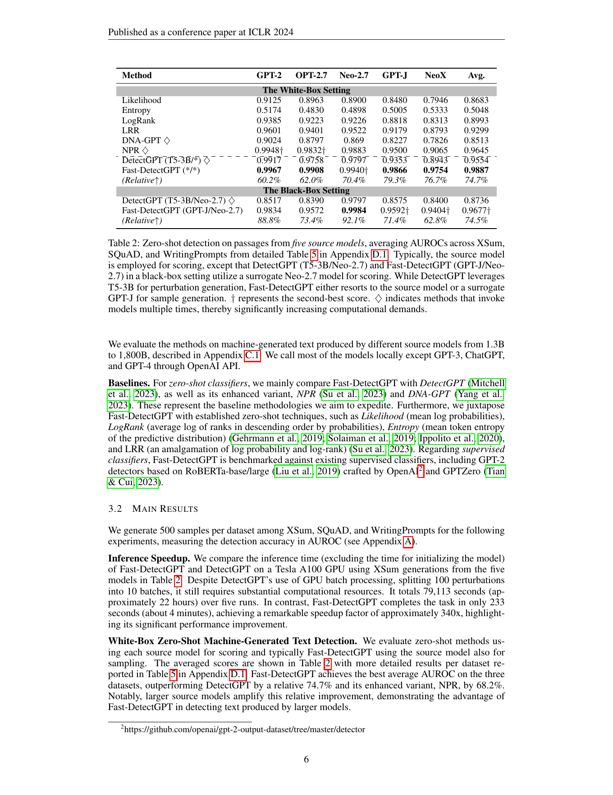
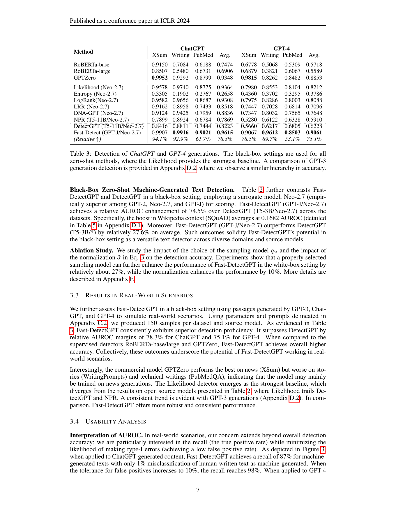

# Fast-DetectGPT: Efficient Zero-Shot Detection of Machine-Generated Text via Conditional Probability Curvature

## 基本信息

- **中文题名**：Fast-DetectGPT：基于条件概率曲率的高效零样本机器生成文本检测
- **作者**：Guangsheng Bao, Yanbin Zhao, Zhiyang Teng, Linyi Yang, Yue Zhang
- **发表信息**：ICLR 2024
- **原始 arXiv**：2023 年 10 月
- **论文链接**：[ICLR 正式版本](https://proceedings.iclr.cc/paper_files/paper/2024/hash/6b8c6f846c3575e1d1ad496abea28826-Abstract-Conference.html)；[arXiv:2310.05130](https://arxiv.org/abs/2310.05130)
- **代码链接**：[baoguangsheng/fast-detect-gpt](https://github.com/baoguangsheng/fast-detect-gpt)
- **本地原文**：[Fast-DetectGPT_ICLR2024.pdf](Fast-DetectGPT_ICLR2024.pdf)，共 23 页

| 章节 | 标题 | 主要内容 |
|---|---|---|
| 1 | Introduction | 指出 DetectGPT 需要反复改写和评分，提出从逐词选择差异入手的高效检测思路。 |
| 2.1 | Task and Settings | 定义人类/机器文本二分类任务，以及白盒和黑盒两种设置。 |
| 2.2 | DetectGPT Baseline | 介绍 DetectGPT 的文本扰动、整体评分与概率曲率。 |
| 2.3 | Fast-DetectGPT | 定义条件概率曲率、条件独立采样和完整检测算法。 |
| 3.1 | Settings | 介绍数据集、生成模型、对比方法和实验配置。 |
| 3.2 | Main Results | 比较推理速度、白盒与黑盒检测效果，并给出消融结果。 |
| 3.3 | Results in Real-World Scenarios | 测试 GPT-3、ChatGPT 与 GPT-4 等不可访问模型的文本。 |
| 3.4 | Usability Analysis | 分析低误报率、文本长度、领域、语言、解码策略和改写攻击。 |
| 4 | Discussion | 讨论白盒接口、代理模型选择、适用范围与理论不足。 |
| 5 | Related Work | 回顾监督式与零样本生成文本检测。 |
| 6 | Conclusion | 总结条件概率曲率的有效性及速度优势。 |
| Appendix | Additional Details | 补充解析解、模型和提示设置、详细结果、消融及攻击实验。 |

## 摘要中文翻译

大语言模型已经能够生成流畅且连贯的内容，这既带来了生产力提升，也带来了社会风险。为了构建可信的人工智能系统，区分机器生成内容和人类创作内容十分必要。领先的零样本检测器 DetectGPT 展现出良好性能，但计算成本很高。本文提出“条件概率曲率”概念，用来说明在给定上下文时，大语言模型与人类在词语选择方面的差异。以这一曲率为基础，作者提出 Fast-DetectGPT：它使用更高效的采样步骤替代 DetectGPT 的文本扰动步骤。作者在不同数据集、源模型和测试条件下进行评估。结果表明，在白盒和黑盒设置中，Fast-DetectGPT 相对 DetectGPT 的性能提升均约为 75%，检测速度则提高约 340 倍，具体结果见 Table 1。

## 研究问题与动机

DetectGPT 的基本观察是：模型生成文本通常位于语言模型概率分布的局部高点。如果把原文轻微改写，模型生成文本的概率通常下降，而人类文本改写前后的概率关系没有这么稳定。这个思路有效，但需要先用 T5 等模型生成约 100 个改写版本，再让评分模型分别计算每个版本的整段概率。

问题在于，自回归模型的后续概率依赖之前所有词。即使改写文本只替换了少量词，后面的上下文也会改变，因此每个版本都要重新运行评分模型。DetectGPT 的计算瓶颈不只来自“生成100篇文本”，还来自“对100条不同的完整概率链重新评分”。

Fast-DetectGPT 改变了比较对象。它不再问：

> 将整篇文章改写后，文章总概率下降了多少？

而是问：

> 在原文的每一个固定上下文中，原文实际选择的词，相对于模型可能选择的其他词，处在概率分布的什么位置？

作者的假设是：语言模型通过大规模语料学习集体统计规律，生成时倾向于选择较高概率的词；具体的人类作者则根据意义、意图和个人表达作出选择，不一定始终贴近模型的高概率区域。因此，模型文本的原始选词更可能显著高于采样替代词，人类文本的这种差异则接近零（见 Figure 1）。

## 核心概念与机制

### 1. 条件概率曲率是什么

**条件概率曲率（conditional probability curvature）**衡量的是：原文实际词语的模型得分，比同一上下文下模型可能抽到的其他词语高出多少。

假设原文是：

```text
小明｜今天｜去｜学校｜上课
```

代理模型看到“小明今天”时，对下一个词给出：

| 候选词 | 模型概率 |
|---|---:|
| 去 | 50% |
| 在 | 20% |
| 没有 | 10% |
| 离开 | 5% |

原文选择了概率最高的“去”。如果整段文本的大多数位置都出现类似情况，原文得分就会显著高于随机采样词的平均得分，形成较大的正曲率。若原文经常选择模型没有优先预测的词，原文得分更接近采样分布，曲率接近零。

论文使用标准化差异表示这一点：

\[
d(x)=\frac{\log p_\theta(x\mid x)-\tilde{\mu}}{\tilde{\sigma}}
\]

其中，原文得分是分子中的第一项；\(\tilde{\mu}\) 和 \(\tilde{\sigma}\) 分别是替代样本得分的均值和标准差。分数越高，表示原文越像模型会作出的高概率选择。

### 2. “条件独立采样”是什么意思

这是论文速度提升的关键。对于第 \(j\) 个位置，采样模型根据**原文前缀** \(x_{<j}\) 生成候选词，但不同位置抽到的词不会改变后续位置的上下文。

仍以原文为例：

```text
位置2的上下文：小明
位置3的上下文：小明今天
位置4的上下文：小明今天去
位置5的上下文：小明今天去学校
```

即使某次采样在位置2抽到“昨天”，位置3仍然根据原文的“小明今天”进行抽样，而不是根据“小明昨天”。因此，这些样本不需要成为语义连贯的新文章；它们只是原文各位置的替代选词组合。

这种设计让所有位置的预测分布都能通过一次模型前向计算得到，并可用张量操作一次抽取大量组合。论文默认抽取 10,000 组，但并不需要调用模型 10,000 次；附录还给出了无需显式采样的解析计算方式。

### 3. 采样模型与评分模型

- **采样模型（sampling model）** \(q_\phi\)：在原文固定上下文中提供候选词分布并抽取替代词。
- **评分模型（scoring model）** \(p_\theta\)：计算原文词和替代词的条件概率。

二者可以相同，也可以不同。如果使用同一个模型，采样和评分可以合并为一次模型调用。白盒设置通常直接使用真实源模型；黑盒设置则需要公开代理模型。

### 4. 它与 DetectGPT 的根本差别



| 维度 | DetectGPT | Fast-DetectGPT |
|---|---|---|
| 比较单位 | 整篇文本及其改写版本 | 原文各位置的实际词与替代词 |
| 对照构造 | 掩码语言模型真正改写文本 | 在固定原文上下文中独立采样 token |
| 评分方式 | 每个改写版本重新计算完整概率链 | 一次前向计算得到各位置分布 |
| 模型调用 | 通常需要数十至上百次 | 可压缩为一次采样和一次评分，模型相同时可合并 |
| 核心统计量 | 整体概率曲率 | 条件概率曲率 |

### 5. 它与 Lastde++ 的关系

两者使用相近的快速采样框架：都固定当前文本的原始上下文，在每个位置独立抽取替代 token，并根据对照分布标准化原文分数。主要区别在于“比较什么”：

- Fast-DetectGPT 汇总原文和替代词的条件对数概率，考察原文是否位于高概率区域。
- Lastde++ 先把逐词概率组成序列，再计算序列的多尺度多样性熵，考察概率变化结构是否过于规律。

因此可以把 Lastde++ 理解为：保留 Fast-DetectGPT 的快速对照采样方式，但把原来的单一条件概率统计换成了同时包含全局概率和局部序列动态的 Lastde 统计量。



## 方法详解

### 输入与输出

- **输入**：待测文本 \(x\)、采样模型 \(q_\phi\)、评分模型 \(p_\theta\) 和决策阈值 \(\epsilon\)。
- **输出**：条件概率曲率分数；当分数超过阈值时，输出“可能为机器生成”。
- **学习方式**：不训练或微调新的分类器，也不需要带标签训练集，但实际部署仍需用目标场景数据选择阈值。

### 算法流程

论文 Algorithm 1 可以用五步概括：

1. 将完整待测文本输入采样模型，取得每个位置的下一词概率分布。
2. 在每个位置根据该分布独立抽取替代 token，组合成大量对照样本。
3. 使用评分模型计算原文实际 token 和所有替代 token 的条件对数概率。
4. 计算对照样本得分的均值和方差，将原文得分标准化。
5. 将标准化曲率与阈值比较，输出风险判断。



### 为什么不需要让对照文本通顺

Fast-DetectGPT要估计的不是“模型重新写一篇文章后会写成什么”，而是“在原文每个上下文中，模型的典型选词概率是多少”。因此，各位置的替代 token 可以独立抽取。它们拼接后即使不连贯，也不影响每个位置的条件概率比较。这种简化正是速度提升的来源，同时也是方法假设的一部分：它放弃了替代文本内部的自回归依赖。

### 白盒与黑盒

- **白盒设置**：知道可能的生成模型，并能读取其完整词元概率。用源模型评分时，原文与评分模型的统计规律匹配，通常效果最好。
- **黑盒设置**：不知道或无法访问源模型，使用 GPT-J、GPT-Neo 等代理模型分别采样和评分。论文假设不同语言模型都学习了人类语言的共同规律，因此代理模型仍能观察到部分高概率选词特征。

黑盒方法最大的风险是模型失配。论文 §4 明确指出，不存在一个模型天然覆盖所有语言和领域；最佳代理模型可能取决于模型规模、训练语料和训练充分程度。

### 阈值的作用

方法最终仍需一个阈值 \(\epsilon\)。提高阈值通常会减少误报，但也会增加漏检；降低阈值则相反。论文没有提供适用于所有应用的永久阈值，而是强调根据实际场景平衡真阳性率和假阳性率。因此，“零样本”不等于“不需要验证集和阈值校准”。

## 实验设计与结果

### 参数设置

| 类别 | 设置 | 说明 |
|---|---|---|
| 数据集 | XSum、SQuAD、WritingPrompts、WMT16 英文/德文、PubMedQA | 覆盖新闻、百科、故事、跨语言和生物医学问答 |
| 样本规模 | 每个数据集随机选择 150–500 篇人类文本，并生成等量机器文本 | 主结果在 XSum、SQuAD、WritingPrompts 中每组使用 500 个样本 |
| 机器文本构造 | 通常以人类文本前 30 个 token 为前缀生成续写 | PubMedQA 只使用问题作为提示 |
| 开源源模型 | GPT-2、OPT-2.7、GPT-Neo-2.7、GPT-J、GPT-NeoX；附录增加 BLOOM、OPT-13、Llama、Llama 2 | 参数规模约 1.3B–20B，另测试更大的闭源模型 |
| 闭源源模型 | GPT-3、ChatGPT、GPT-4 | 用于黑盒真实场景实验 |
| 黑盒采样/评分模型 | 主设置为 GPT-J / GPT-Neo-2.7 | 两个代理模型分别负责采样和评分 |
| 默认采样数 | 10,000 组 token 组合 | 通过一次张量采样完成，而非 10,000 次模型调用 |
| DetectGPT 配置 | 默认 100 个扰动文本 | 每个扰动通常需要重新评分 |
| 运行环境 | Tesla A100 GPU | 速度实验排除模型初始化时间 |
| 对比方法 | Likelihood、Entropy、LogRank、LRR、DetectGPT、NPR、DNA-GPT、RoBERTa 检测器、GPTZero | 同时覆盖零样本、扰动式和监督式方法 |

### 实验指标

| 指标 | 含义 | 用途 |
|---|---|---|
| AUROC | 汇总所有阈值下真阳性率与假阳性率的排序能力 | 论文主要准确性指标；0.5 近似随机，1 为完全区分 |
| TPR / Recall | 机器文本中被正确检出的比例 | 观察检测器能抓住多少生成文本 |
| FPR | 人类文本被错误标成机器文本的比例 | 学术评审等高风险场景尤其重要 |
| 推理时间 | 完成同一检测任务的运行时间 | 衡量方法是否适合规模化应用 |
| Relative improvement | \((new-old)/(1-old)\) | 表示相对于 AUROC 理论上限 1.0 所实现的剩余提升比例，不等于 AUROC 直接增加 75 个百分点 |

### 实验结果分析

#### 1. 速度提升

在 XSum 上对五个源模型进行五轮测试时，DetectGPT 总计耗时 79,113 秒，约 22 小时；Fast-DetectGPT 用时 233 秒，约 4 分钟，速度提高约 **340 倍**（§3.2）。需要注意，这个数字来自特定 A100、数据量和批处理设置，但两者的模型调用数量差异确实构成结构性优势。

#### 2. 开源模型上的白盒与黑盒结果

Table 2 显示，在五种开源源模型和三个主要数据集上：

- 白盒 Fast-DetectGPT 平均 AUROC 为 **0.9887**，DetectGPT 为 0.9554，NPR 为 0.9645。
- 黑盒 Fast-DetectGPT 平均 AUROC 为 **0.9677**，黑盒 DetectGPT 为 0.8736。
- 论文所说的“相对提升约 75%”使用的是距离满分还剩多少空间的相对计算，白盒 AUROC 的绝对差值实际为 0.0333，黑盒为 0.0941。



附录 Table 5–6 表明，这一优势在更多模型上大体保持，但并非每个单项都领先：例如 XSum/GPT-2 等少数设置中，NPR 或 DetectGPT 略高；黑盒模型失配时，提升幅度也会减小。论文因此更有力地支持“平均表现和效率更强”，而不是“任何模型、任何领域都必然最佳”。

#### 3. ChatGPT 与 GPT-4 黑盒检测

Table 3 使用 GPT-J 采样、GPT-Neo-2.7 评分：

- ChatGPT 三个数据集平均 AUROC 为 **0.9615**，DetectGPT 为 0.8223。
- GPT-4 平均 AUROC 为 **0.9061**，DetectGPT 为 0.6228。
- GPT-4 明显比 ChatGPT 更难检测，特别是在 PubMedQA 上，Fast-DetectGPT 为 0.8503。



Figure 3 进一步报告，在 ChatGPT 文本上，当人类文本误报率控制为 1% 时，机器文本召回率约为 **87%**；允许 10% 误报时，召回率约为 98%。这同时说明方法具有应用潜力，也说明低误报要求下仍有约 13% 的 ChatGPT 文本漏检。

#### 4. 文本长度、领域与语言

Figure 4 显示，Fast-DetectGPT 的 AUROC 随测试文本变长而较稳定地上升，符合统计检测器需要足够 token 才能积累证据的特点。Figure 5 中，它在分布外的 PubMedQA 和 WMT16 德文上优于监督式检测器，并持续优于 DetectGPT。不过实验只覆盖有限语言和数据集，不能据此推出对所有专业领域和低资源语言都稳定。

#### 5. 消融实验

附录 Table 8 表明，采样模型的选择会影响结果；在部分白盒实验中，使用较强的 GPT-J 采样甚至优于直接使用源模型采样。标准差归一化也带来约 10% 的相对提升。这说明性能不仅来自原文平均概率，还来自选择合适的参照分布并按其离散程度校准。

#### 6. 解码策略与改写攻击

附录显示，Fast-DetectGPT 在 top-k、top-p 和温度采样下都优于 DetectGPT；生成越确定，通常越容易检测。改写攻击会降低所有方法的性能：Table 11 中，Fast-DetectGPT 的平均 AUROC 从 0.9641 降至约 **0.8715**，但仍高于其他方法。作者同时发现其逐句改写破坏了跨句连贯性，因此这项攻击实验不能完整代表高质量人工润色或专门的检测规避。

### 证据强度与论文局限

论文对“比 DetectGPT 快很多”的证据非常直接：两种算法的调用方式不同，并有同硬件计时结果支持。对“准确率更高”的结论，也有多个模型、领域、语言和闭源模型实验支持。

但更宽泛的“真实场景可靠性”仍需谨慎：

- 黑盒性能依赖代理模型与真实生成模型是否共享统计规律。
- 方法假设模型更倾向高概率词，但不同微调和解码策略可能削弱这一倾向。
- 短文本证据较少，改写后性能会下降。
- 攻击实验没有覆盖强对抗规避、复杂人机协作或高质量编辑。
- 作者承认理论分析不足，工作主要是经验性验证。
- AUROC 很高不代表部署阈值下误报可以忽略，尤其当人类文本占绝大多数时。

## 这篇论文带给我的启发

### 1. 在论文评审系统中的合理定位

Fast-DetectGPT可以作为“文本来源风险筛查模块”，快速扫描论文中的长段自然语言，给出需要复核的位置。它不适合检查公式、表格、代码、参考文献，也不能判断论文的思想、实验或数据是否由作者完成。最重要的是，它检测的是统计意义上的高概率选词，不是作者身份或违规事实。

### 2. 评审量规不能只写“AI概率”

更合理的输出至少应拆成：文本长度是否足够、使用了什么代理模型、曲率分数、阈值对应的已知 FPR/TPR、该学科是否参与过校准，以及多个段落的结果是否一致。系统应显示“统计异常，需要复核”，而不是显示看似精确的“AI生成率 93%”。

### 3. 应建立可追溯的证据链

对每次检测，应保存：论文版本、段落位置和哈希、语言和文本长度、分词器、采样模型与评分模型版本、各位置原文 token 的条件概率、对照分布均值与标准差、最终曲率、阈值来源和人工复核结果。只有保留这些信息，评审者才能重现结论，作者也才有申诉和解释的可能。

### 4. 人工复核应该检查什么

风险分数较高后，不应直接判断代写，而应转向更能反映学术责任的证据：

- 引用是否真实且真正支持相关论断；
- 研究问题、方法、实验和结论是否前后一致；
- 数据、代码、实验日志和版本记录是否可追溯；
- 作者能否解释关键研究选择和异常结果；
- AI 使用是否符合当前机构和期刊的披露政策。

### 5. 必须设置的误判防护

- 短文本、标题、图注、固定模板、伦理声明和参考文献不做确定判断。
- 非母语作者、翻译文本、统一语言润色文本必须单独校准。
- 按学科和文体建立人类基线，不能用新闻或故事数据的阈值直接检测学术论文。
- 使用多个结构和语料不同的代理模型，检查结论是否对模型选择敏感。
- 高风险结果必须进入人工复核，不得自动拒稿、撤稿或启动处罚。

### 6. 对自动论文评审研究的进一步启发

我认为这篇论文最可迁移的思想并不是“找到了一个万能 AI 检测器”，而是**在相同条件下建立参照分布，再评价当前对象在分布中的相对位置**。这一思想还可用于创新性评估：不要只让模型直接打“创新分”，而应在相同研究问题、年份和领域中检索一组相关论文，建立正常相似度和贡献差异的参照分布，再标出需要专家复核的异常接近或异常新颖之处。

此外，Fast-DetectGPT 与 Lastde++ 的连续关系也提示了一条研究路线：采样框架可以保持不变，但用于评审的统计量可以更丰富。未来可以将条件概率曲率、多尺度序列复杂度、引用可靠性、事实一致性和写作过程证据组合成多证据系统，并通过真实投稿数据评估误报、漏报、公平性与人工复核成本，而不是把任何单一检测分数作为最终结论。
