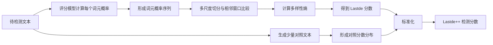
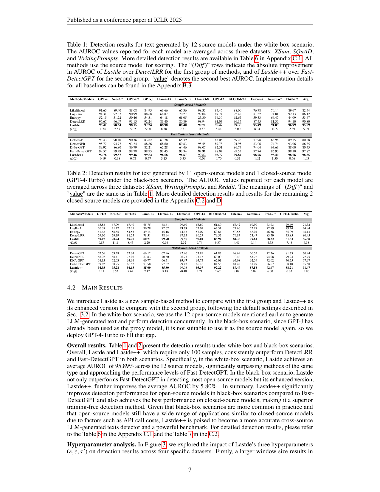

# Training-free LLM-generated Text Detection by Mining Token Probability Sequences

## 基本信息

- **中文题名**：通过挖掘词元概率序列实现免训练的大语言模型生成文本检测
- **作者**：Yihuai Xu, Yongwei Wang, Yifei Bi, Huangsen Cao, Zhouhan Lin, Yu Zhao, Fei Wu
- **发表信息**：ICLR 2025
- **论文链接**：[arXiv:2410.06072](https://arxiv.org/abs/2410.06072)
- **代码链接**：[TrustMedia-zju/Lastde_Detector](https://github.com/TrustMedia-zju/Lastde_Detector)
- **本地原文**：[Lastde_Lastde++_ICLR2025.pdf](Lastde_Lastde++_ICLR2025.pdf)

| 章节 | 标题 | 主要内容 |
|---|---|---|
| 1 | Introduction | 指出现有免训练检测器只看单个词元或局部扰动，忽略了整段概率序列的结构。 |
| 2 | Related Work | 回顾监督式检测、零样本统计检测和基于扰动的检测。 |
| 3 | Method | 将词元对数概率看作时间序列，提出多尺度多样性熵、Lastde 与 Lastde++。 |
| 4 | Experiments | 在多领域、多模型、多语言和改写攻击条件下比较检测效果。 |
| 5 | Conclusion | 总结序列结构信号的价值，并强调检测结果只能作为辅助证据。 |

## 摘要中文翻译

大语言模型生成的文本越来越接近人类写作，使可靠检测变得困难。现有免训练方法通常依赖单个词元的概率统计，或通过反复扰动文本估计其概率曲面，但这些方法没有充分利用词元概率随文本推进而形成的序列结构。本文把词元概率序列视作时间序列，并发现人类文本的概率变化通常比模型生成文本更复杂、更多样。基于这一观察，作者提出多尺度多样性熵，用来衡量概率序列在不同尺度上的变化程度，并据此构造 Lastde 检测分数。进一步地，Lastde++ 使用模型快速采样得到的对照文本对分数进行标准化，从而减弱不同文本和模型造成的偏移。实验覆盖多种数据领域、生成模型、语言和改写攻击。结果表明，两种方法总体优于已有免训练检测器，Lastde++ 在只使用较少采样文本的情况下仍表现出较强的准确性与鲁棒性。

## 一句话总结

Lastde++ 不只问“这段话在模型看来概率高不高”，而是进一步观察这些概率沿文本展开时是否过于规律，再用同一模型生成的对照文本校准判断。

## 研究问题与动机

常见零样本检测方法主要有两类：第一类计算平均对数似然、排名或熵，最后把整段文本压缩成一个简单统计量；第二类反复改写原文，再比较改写前后的概率变化。前者忽略了词元之间的连续结构，后者需要多次生成，成本较高，而且改写模型本身也会引入偏差。

作者观察到：人类写作在选词、句式和语义推进上更不规则，因此词元的条件概率会出现更丰富的起伏；模型生成通常沿着较高概率的路径连续选择，概率序列相对平滑、重复。这个现象并不等于“人类文本概率一定更低”，真正有区分力的是整条序列的变化方式。

因此，论文研究的不是一个新的分类器，而是一种新的文本表示：**词元概率序列（Token Probability Sequence, TPS）**。它把每个词元在给定前文条件下的对数概率按顺序排列，使生成文本检测转化为序列复杂度比较。

## 核心概念与机制

### 1. 词元概率序列

对文本中的每个词元，使用一个可访问概率的语言模型计算其条件对数概率，并按原顺序排列：

\[
T(x)=[\log p(x_1),\log p(x_2|x_{<2}),\ldots,\log p(x_n|x_{<n})]
\]

白盒设置可直接使用生成该文本的模型；黑盒设置则使用 GPT-J 等代理模型。论文表明，代理模型与真实生成模型的接近程度会显著影响检测表现。

### 2. 多尺度多样性熵

**多尺度多样性熵（Multiscale Diversity Entropy, MDE）**用于衡量概率序列的复杂程度。其过程可以概括为：

1. 对原始概率序列做多尺度处理，观察短距离与较长距离的变化。
2. 在每个尺度上用滑动窗口切出相邻片段。
3. 计算相邻窗口之间的余弦相似度。
4. 将相似度离散到若干状态，统计状态分布并计算熵。
5. 汇总多个尺度的熵，得到整段文本的序列多样性。

可以把“多尺度多样性熵”理解成：**检查一段文本的词元概率，究竟变化得有多丰富，以及这种丰富性在不同观察范围下是否仍然存在。**

熵越高，说明概率变化方式越丰富；熵越低，说明序列越规则。

论文 Figure 2 展示了完整流程。

## 第一步：把文本变成概率序列

语言模型逐词阅读文本，并给每个词一个概率。为了方便，假设得到：

```
0.8，0.7，0.9，0.8，0.7，0.9，0.8
```

这段序列比较规律。

另一段可能是：

```
0.8，0.2，0.7，0.4，0.9，0.3，0.6
```

这段序列变化更复杂。

论文认为：

- 大模型生成文本通常连续选择比较合理、概率较高的词，因此序列相对规律；
- 人类会突然换词、转折或改变表达，概率序列往往更加不规则。

但只看“上下波动大不大”还不够，因为有些序列虽然波动很大，却可能一直重复同一种模式。因此论文要进一步计算“变化方式是否丰富”。

## 第二步：“多尺度”

同一条概率序列，可以用不同的范围观察。

假设原始序列是：

```
1，5，2，6，1，5，2，6
```

### 尺度 1：逐个观察

直接保留原序列：

```
1，5，2，6，1，5，2，6
```

这时主要看到每个词之间的快速变化。

### 尺度 2：每两个数取平均

```
(1+5)/2，(2+6)/2，(1+5)/2，(2+6)/2
```

得到：

```
3，4，3，4
```

这时忽略了一些局部变化，观察较大的变化趋势。

### 尺度 3：每三个相邻数取平均

又会得到一条更加平滑的序列，用来观察更长范围内的结构。

所以，多尺度就是：

- 小尺度看相邻词之间的变化；
- 中尺度看短语附近的变化；
- 大尺度看更长文本范围内的变化。

如果只看一个尺度，检测结果容易被偶然的局部波动影响。

## 第三步：使用滑动窗口切分序列

假设某个尺度下的序列为：

```
1，2，3，3，4，5
```

窗口长度设为 3，就可以切成：

```
窗口 1：[1，2，3]
窗口 2：[2，3，3]
窗口 3：[3，3，4]
窗口 4：[3，4，5]
```

这些窗口代表概率序列中的连续局部形状。

接下来，论文比较相邻窗口是否相似：

```
窗口1 和 窗口2
窗口2 和 窗口3
窗口3 和 窗口4
```

使用的是余弦相似度。暂时不必关心公式，只需知道：

- 相似度高：前后两段概率变化模式接近；
- 相似度低：前后两段变化方式不同。

## 第四步：统计出现了多少种变化模式

假设相邻窗口的相似度为：

```
0.92，0.90，0.91，0.89，0.93
```

这些值都集中在同一范围，说明局部模式一直很相似，变化方式比较单一。

另一段文本可能得到：

```
0.91，0.35，0.72，0.10，0.84
```

相似度分散在不同范围，说明文本中的概率变化模式更加丰富。

论文会把相似度划分成若干区间，例如：

```
0～0.2
0.2～0.4
0.4～0.6
0.6～0.8
0.8～1.0
```

然后统计各区间出现的次数。

### 情况一：集中在少数区间

```
0～0.2：0 次
0.2～0.4：0 次
0.4～0.6：0 次
0.6～0.8：1 次
0.8～1.0：9 次
```

变化模式比较单一，熵较低。

### 情况二：分散在多个区间

```
0～0.2：2 次
0.2～0.4：2 次
0.4～0.6：2 次
0.6～0.8：2 次
0.8～1.0：2 次
```

变化模式更加多样，熵较高。

这里的“熵”衡量的就是：**这些相似度结果分布得有多分散。**

## 第五步：综合多个尺度

每个尺度都会得到一个多样性熵：

```
尺度 1：0.72
尺度 2：0.65
尺度 3：0.69
```

或者：

```
尺度 1：0.80
尺度 2：0.31
尺度 3：0.75
```

Lastde 会综合这些尺度的结果，得到整段文本的复杂度特征。

不过需要注意，论文发现的只是统计倾向：人类文本通常更复杂，模型文本通常更规律。它不是绝对规律，公式化的人类论文可能很规则，经过复杂提示或改写的模型文本也可能非常不规则。


### 3. Lastde 分数

Lastde 将文本的平均对数似然与多尺度多样性熵结合。直观上，模型生成文本往往具有较高平均概率、较低变化多样性，因此二者的比值能够放大差异。论文默认使用不同尺度熵值的标准差进行汇总；主要参数包括尺度数、离散区间数和滑动窗口长度。

### 4. Lastde++ 的对照校准

原始 Lastde 分数会受文本主题、长度和代理模型影响。Lastde++ 让**同一个评分模型**根据原文前缀快速生成一组对照文本，计算这些文本的 Lastde 分布，再把待测文本的分数转成标准分数：

\[
z(x)=\frac{Lastde(x)-\mu_{sample}}{\sigma_{sample}}
\]

这里的关键不是重新训练，而是为当前输入临时建立参照系。论文默认采样 100 个对照文本；当评分模型和采样模型相同时，两步还可以合并执行。




## 实验设计与结果

### 数据与参数设置

| 项目 | 设置 |
|---|---|
| 数据领域 | XSum 新闻、SQuAD 问答、WritingPrompts 故事、Reddit ELI5、WMT16 英德文本、中文知乎文本 |
| 样本构造 | 每个数据集抽取 150 篇人类文本；使用前 30 个词元作为提示生成续写 |
| 生成模型 | 最多覆盖 18 个来源，包括 15 个 1.3B–13B 开源模型，以及 GPT-4-Turbo、GPT-4o、Claude-3-Haiku |
| 黑盒代理模型 | 默认 GPT-J |
| Lastde 默认参数 | 尺度数 3；离散区间约为文本长度的 10 倍；窗口长度 5 |
| Lastde++ 默认参数 | 100 个对照样本；尺度数 4；离散区间约为文本长度的 8 倍；窗口长度 15 |
| 对比方法 | Likelihood、LogRank、Entropy、DetectLRR、DetectGPT、DetectNPR、DNA-GPT、Fast-DetectGPT |

### 实验指标

| 指标 | 含义 | 注意点 |
|---|---|---|
| AUROC | 在所有分类阈值下综合衡量人类与生成文本的排序能力 | 高 AUROC 不代表部署阈值下的误判率一定低 |
| 性能下降值 | 比较改写、跨语言或代理模型变化前后的 AUROC 差异 | 用于观察鲁棒性，而非只看理想条件下的峰值 |
| 采样数量 | Lastde++ 建立参照分布所需的生成次数 | 反映计算成本与检测效果的平衡 |

### 主要结果

论文 Table 1–2 给出核心结果。白盒设置下，Lastde 在 12 个源模型上的平均 AUROC 为 **95.89**，相比 DetectLRR 的 90.80 提高 5.09；Lastde++ 达到 **98.85**，相比 Fast-DetectGPT 的 97.82 提高 1.03。黑盒设置下，Lastde 平均 AUROC 为 **86.38**，Lastde++ 为 **91.47**；对应的较强基线分别为 80.45 和 85.68。



论文 Figure 4 表明，Lastde++ 只使用 10 个采样文本时，整体表现已经超过使用 100 个采样文本的 Fast-DetectGPT，说明对照样本的利用效率较高。Figure 5 则显示短文本仍然困难；文本长度超过约 120 词后，Lastde 和 Lastde++ 的优势更加稳定。

在改写攻击实验（Table 3）中，所有方法都会退化。以白盒 XSum 为例，Lastde++ 从 97.75 降至 89.27；黑盒 XSum 从 82.57 降至 73.43。它通常比 Fast-DetectGPT 下降更少，但“更鲁棒”不等于“不受影响”。跨语言实验中，Lastde++ 在英文和德文上相对 Fast-DetectGPT 分别提高约 5.24 和 4.56 AUROC，在中文上优势较小。

